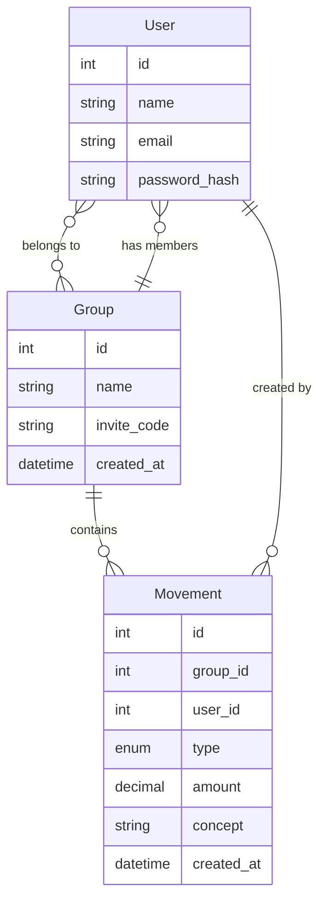

# CoCapital — Shared Capital Management Platform

> **Status:** Specified after grilling session (Jun 30, 2026)
> **Next step:** Enter prototype phase → validate with real users

## Problem

Two friends in Lima, Peru pool money (S/500 each = S/1000 total) to resell perfumes and lend to clients. They track movements in personal notebooks + WhatsApp. They have **zero visibility** into:
- Total capital right now
- Which activity is more profitable
- ROI, trends, or performance

They don't use spreadsheets because sharing/formatting/editing on phone is painful.

## Users (first pair)

| Person | Role |
|--------|------|
| Friend A (founder's contact) | Co-manager, records purchases & loans |
| Friend B | Co-manager, records sales & repayments |

Both use phones as primary device.

## Solution — MVP

A phone-first shared log where each movement is recorded in ~10 seconds and total capital updates instantly.

### App flow (textual)

```
1. Register/Login (email + password)
2. Create a group → get a shareable link
3. Other joins via link
4. Either member records a movement:
   ┌─────────────────────┐
   │ S/  │  [amount]     │
   │ Concept │ [what for] │
   │ Type ▼ │ [pick one]  │
   │─────────────────────│
   │ ○ Contribute         │
   │ ○ Buy inventory      │
   │ ○ Sell inventory     │
   │ ○ Lend to client     │
   │ ○ Client repaid      │
   │ ○ Expense            │
   └─────────────────────┘
5. Dashboard instantly shows:
   - Total capital
   - Where it is (cash / inventory / lent)
   - Recent movements
```

### Movement types

| Type | Effect | Example |
|------|--------|---------|
| **Contribute** | Cash +, Capital + | "Aporté S/200" |
| **Buy inventory** | Cash –, Inventory + | "Compré 5 perfumes" |
| **Sell inventory** | Cash +, Inventory –, Profit recorded | "Vendí perfume X" |
| **Lend to client** | Cash –, Lent + | "Presté S/100 a Juan" |
| **Client repaid** | Cash +, Lent –, Interest recorded | "Juan pagó S/120" |
| **Expense** | Cash –, Capital – | "Pasaje S/10" |

### Data model



### Dashboard indicators

| Indicator | How it's calculated |
|-----------|-------------------|
| **Total Capital** | Sum all contributions – expenses + profits from sales/interest |
| **Where it is** | Cash = contributions not yet spent; Inventory = cost of items bought; Lent = outstanding loans |
| **Recent activity** | Last 10 movements, newest first |

### Out of scope (MVP)

- Forecasting, projections, ROI calculations
- Advanced accounting (double-entry, P&L statements)
- Notifications, reminders
- Historical comparisons, charts
- Multiple groups per user (one group per account is fine)
- Payment integrations

## Riskiest assumption

That both friends will consistently record every movement on their phones instead of their notebooks. If recording feels like work, they'll abandon it. **The prototype must prove the 10-second recording flow works on mobile.**

## How we'll validate

- Build a working prototype (web app, mobile-responsive)
- Give it to the two friends
- Measure: do they record ≥ 5 movements each in the first week?
- Ask: "Would you be upset if this app disappeared?"

---

## Record of decisions

| # | Decision | Rationale |
|---|----------|-----------|
| 1 | Phone-first, web (not native app) | Faster to prototype, responsive web works on any phone |
| 2 | Single-entry movements (not double-entry) | Phone UX — one tap per event |
| 3 | Movement types fixed list | Covers their actual use cases, avoids choice paralysis |
| 4 | Register + login before group | Easy to build, familiar pattern |
| 5 | Invite via shareable link | No search/request flow needed for 2-person group |
| 6 | No forecasts or ROI in MVP | No historical data yet to calculate from |
| 7 | Stack: Next.js + TypeScript | Founder's comfort zone, fast to prototype |
| 8 | UI: shadcn/ui + Tailwind | Lightweight, mobile-first, full code ownership |
| 9 | Auth: Clerk | Pre-built UI, 50K free users, unlimited apps |
| 10 | Database: Neon + Drizzle ORM | Serverless Postgres, edge-ready (neon-http driver), branch-per-env; TS-native. (Switched from Turso 2026-07-06.) |
